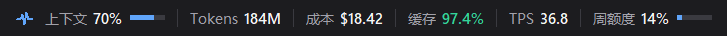
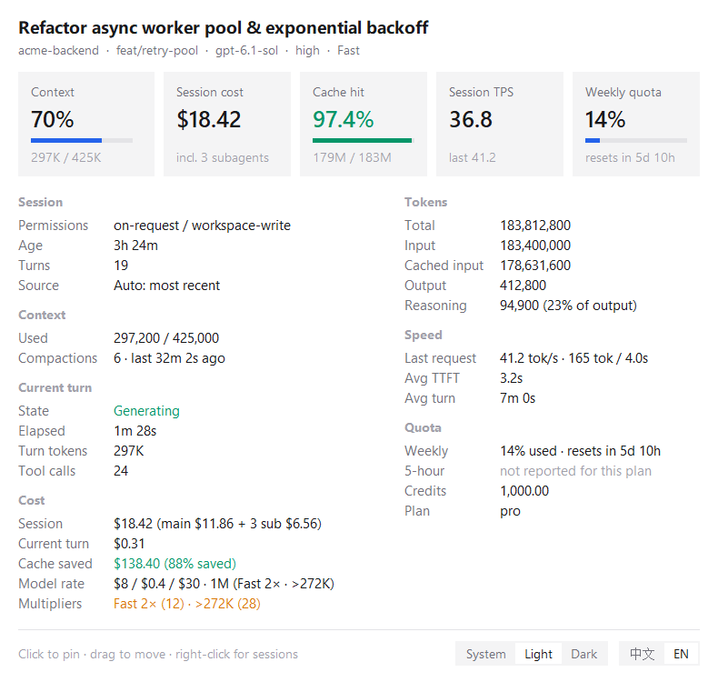
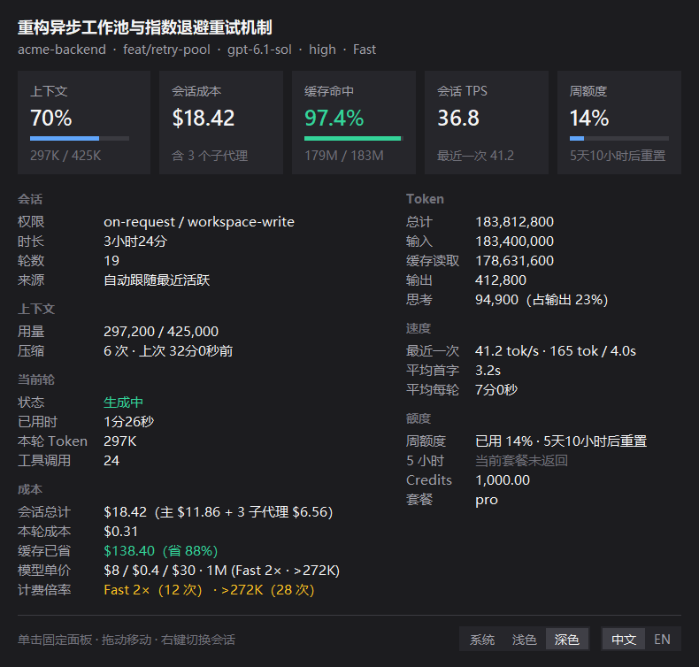
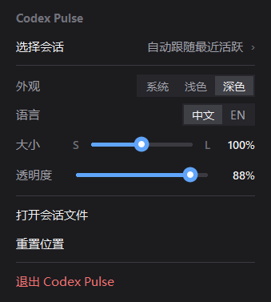

<div align="center">

# Codex Pulse

**Non-intrusive floating status bar & real-time token, cache, TPS, API cost, and quota dashboard for OpenAI Codex Desktop on Windows**

[](https://github.com/hzh030430/codex-pulse/releases)
[](https://github.com/hzh030430/codex-pulse/actions)
[](LICENSE)
[](#)
[](#)

[中文](README.md) | **English**

<br/>



</div>

---

## Screenshots

<table>
  <tr>
    <td align="center" width="50%">
      
      <br /><sub><b>Light Mode · English Detail Dashboard</b> (with subagent costs &amp; Fast / &gt;272K multipliers)</sub>
    </td>
    <td align="center" width="50%">
      
      <br /><sub><b>Dark Mode · Chinese Detail Dashboard</b></sub>
    </td>
  </tr>
</table>

<div align="center">
  
  <br /><sub><b>Fluent Context Menu</b> (Session switcher · Theme &amp; Language · Smooth linear S–L size &amp; 0%–100% opacity sliders)</sub>
</div>

---

## Highlights

- **True Z-Order Window Docking (Never Steals Focus)**
  - Docks cleanly inside the bottom-right corner of the OpenAI Codex Desktop window and follows movement/resizing instantaneously via Win32 `WinEvent` hooks.
  - Sits **directly above Codex in the window Z-order** rather than forcing global `Always-on-Top`: stays visible when you focus your IDE or browser while Codex is side-by-side, and naturally hides or slips underneath whenever another window covers Codex or when Codex is minimized.
- **6 Always-On Strip Metrics**
  - `Context │ Tokens │ Cost │ Cache │ TPS │ Weekly` with color-coded progress bars and warning thresholds.
- **Hover-to-Peek / Click-to-Pin Two-Column Dashboard**
  - **5 KPI Summary Cards**: Context ratio, Session API-equivalent cost, Prompt cache hit rate, Session TPS, and Weekly quota countdown.
  - **7 Detail Sections**: Session metadata, Context & compactions, Current turn state & tool calls, **Cost breakdown**, Token breakdown (including reasoning share), Throughput & TTFT latency, and Plan/Credits quota.
- **Per-Request Official OpenAI API Cost Engine**
  - Prices every request individually across mid-session model switches and Fast-mode toggles.
  - Accounts for prompt cache discounts (90%–95%), **Long-Context (`>272K` input tokens: `2×` input/cached, `1.5×` output)**, and **Fast / Priority mode (`2×`, stackable with `>272K`)**.
  - Recursively aggregates all **spawned subagent threads** via `state_5.sqlite` (`thread_spawn_edges`), displaying main vs. subagent cost and total dollars saved by prompt caching.
- **Polished Customization**
  - **System / Light / Dark** themes (with native Windows 11 DWM rounded corners and border tinting) + instant **English / 中文** switching.
  - Anti-aliased linear sliders for **Size (`S`–`L`, `75%`–`125%`)** on top of Per-Monitor DPI v2 scaling, and **Opacity (`0%`–`100%`)** with `0%` click-through protection.
- **100% Local Read-Only · Zero External Dependencies**
  - Built purely on the Python 3.10+ standard library (`tkinter`, `ctypes`, `sqlite3`).
  - Strictly read-only access to `~/.codex/sessions/**/rollout-*.jsonl` and `~/.codex/state_*.sqlite` (`?mode=ro`): **zero network calls, never touches `auth.json` or credentials, never modifies Codex files**.

---

## Quick Start

> **Requirements**: Windows 10 / 11 + [Python 3.10+](https://www.python.org/downloads/windows/) (standard python.org installer includes `tkinter` out of the box; zero `pip` packages needed).

### Option 1: Portable Release Bundle (Recommended)

1. Download `CodexPulse-v1.0.0-windows-portable.zip` from [**Releases**](https://github.com/hzh030430/codex-pulse/releases) and extract it anywhere.
2. Run the one-click setup script in PowerShell (creates a `Codex Pulse` Desktop shortcut and launches silently):
   ```powershell
   powershell -ExecutionPolicy Bypass -File .\install.ps1
   ```
   - Add `-Autostart` to also launch automatically at Windows sign-in.
   - Or simply double-click **`Start Codex Pulse.vbs`** directly!

### Option 2: From Source (`git clone`)

```powershell
git clone https://github.com/hzh030430/codex-pulse.git
Set-Location .\codex-pulse

# Create Desktop shortcut & start in background (no console window)
powershell -ExecutionPolicy Bypass -File .\install.ps1

# Print a one-shot summary in the terminal without opening the overlay
python -m codex_pulse --once

# Stop background process & remove shortcuts (pass -PurgeSettings to also delete config)
powershell -ExecutionPolicy Bypass -File .\uninstall.ps1
```

### Option 3: `pip` / `uv` Package Install

```powershell
python -m pip install .
# or:
uv tool install .

# Launch GUI status bar (windowless entry point)
codex-pulse

# One-shot CLI snapshot
codex-pulse-cli --once
```

---

## Configuration

Settings are persisted at `%APPDATA%\CodexPulse\settings.json`:

```json
{
  "theme": "system",
  "lang": "en",
  "size": 1.0,
  "opacity": 100,
  "offset": [16, 10],
  "pinned_thread": null,
  "pricing": {
    "my-custom-model": [2.0, 0.2, 10.0]
  }
}
```

- Environment overrides: `CODEX_HOME` (custom `.codex` directory) and `CODEX_PULSE_EXE` (explicit path to `Codex.exe`).
- Logs: `%APPDATA%\CodexPulse\codex-pulse.log`.

## License

Released under the [MIT License](LICENSE).
