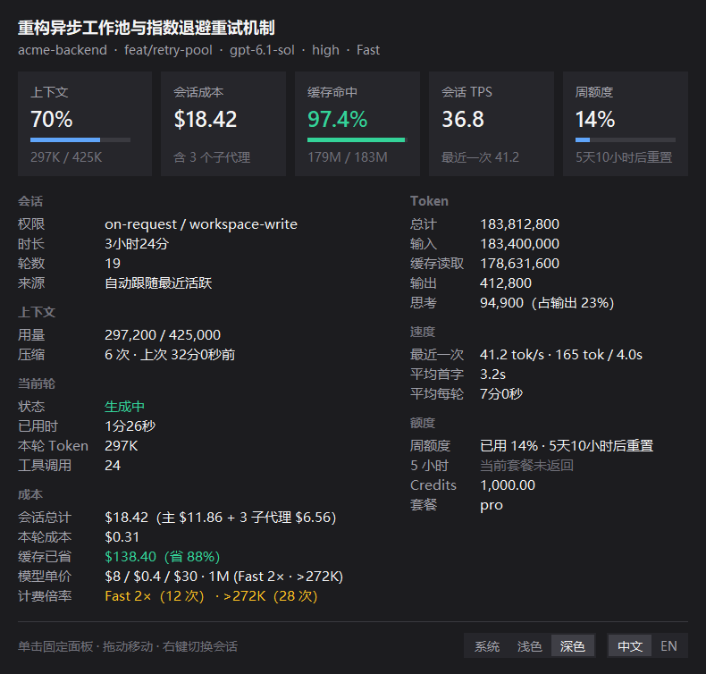
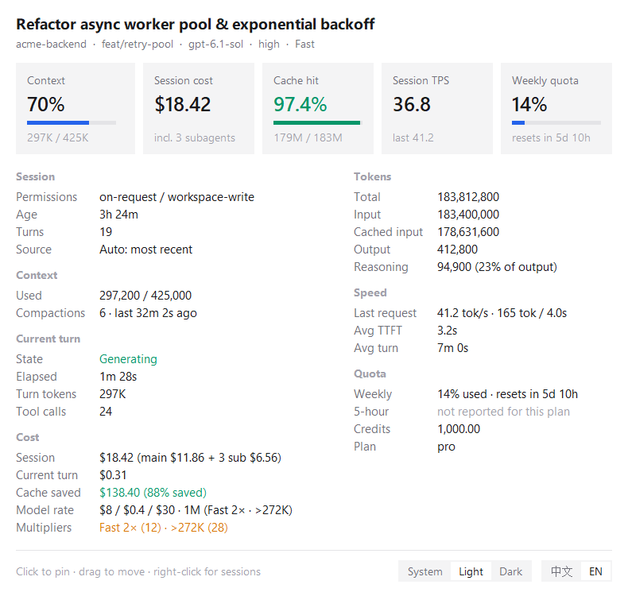
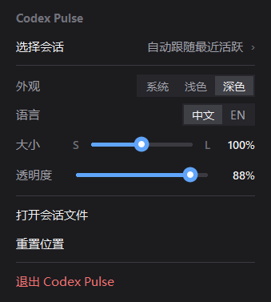

<div align="center">

# Codex Pulse

**面向 OpenAI Codex 桌面版（Windows）的轻量悬浮状态条与实时会话成本 / 性能监控面板**

[](https://github.com/hzh030430/codex-pulse/releases)
[](https://github.com/hzh030430/codex-pulse/actions)
[](LICENSE)
[](#)
[](#)

**中文** | [English](README.en.md)

<br/>


</div>

---

## 预览

<table>
  <tr>
    <td align="center" width="50%">
      
      <br /><sub><b>深色模式 · 中文详情面板</b>（含子代理成本与 Fast / &gt;272K 倍率）</sub>
    </td>
    <td align="center" width="50%">
      
      <br /><sub><b>浅色模式 · 英文详情面板</b>（Light Mode · English UI）</sub>
    </td>
  </tr>
</table>

<div align="center">
  
  <br /><sub><b>Fluent 风格右键菜单</b>（会话切换 · 主题/语言 · 线性大小 S–L 与 0%–100% 透明度滑条）</sub>
</div>

---

## 核心特性

- **无感窗口贴合（Z-Order 跟随，绝不抢焦点）**
  - 默认贴合在 Codex 桌面窗口右下角内侧，利用 Win32 `WinEvent` 钩子实时跟随移动与缩放。
  - 处于窗口层级中 **Codex 正上方一格**（而非全局强行置顶）：焦点切到 IDE 或浏览器时状态条依然稳定显示；其他窗口遮挡 Codex 或最小化/切换虚拟桌面时，状态条自动随之被遮挡或隐藏。
- **6 项常驻核心指标**
  - `上下文 │ Tokens │ 成本 │ 缓存 │ TPS │ 周额度` 一目了然，上下文与周额度带动态进度条与阈值预警变色。
- **悬停弹出 / 单击固定双栏详情面板**
  - **5 张 KPI 卡片**：上下文占比、会话成本、缓存命中率、会话平均 TPS、周额度剩余重置倒计时。
  - **7 组结构化明细**：会话（权限、时长、轮数、来源）、上下文（精确用量、压缩次数与上次压缩时间）、当前轮（生成状态、耗时、Token、工具调用数）、**成本**、Token 拆分（含思考 Token 占比）、速度（最近一次请求、平均首字 TTFT、平均每轮耗时）、额度（周额度、5 小时窗口、Credits、套餐）。
- **按 OpenAI 官方计费规则逐请求核算 API 等效成本**
  - 逐条解析会话请求记录，中途切换模型、开关 Fast 模式均可精准分段计费。
  - 完整计入提示词缓存折扣（90%–95%）、**`>272K` 长上下文阶梯倍率（输入/缓存 `2×`、输出 `1.5×`）**、**Fast 优先档位倍率（`2×`，可与长上下文叠加）**。
  - 通过 `state_5.sqlite` 的派生关系递归统计当前会话拉起的**全部子代理（Subagents）花费**，展示「主会话 + 子代理」拆分与缓存已省金额。
- **高颜值个性化体验**
  - 支持 **跟随系统 / 浅色 / 深色** 三种外观模式（适配 Windows 11 原生圆角与 DWM 边框色）及 **中 / 英** 双语即时切换。
  - 右键菜单内置抗锯齿平滑线性滑条，支持 **`S`–`L`（`75%`–`125%`）无级尺寸缩放**（叠加系统高分屏 Per-Monitor DPI v2）与 **`0%`–`100%` 线性透明度调节**（`0%` 时保留防穿透保护，仍可在原位右键唤出菜单）。
- **100% 纯本地只读 · 零第三方依赖**
  - 仅依赖 Python 3.10+ 标准库（`tkinter`、`ctypes`、`sqlite3`），无需 `pip install` 任何第三方包。
  - 严格只读 `~/.codex/sessions/**/rollout-*.jsonl` 与 `~/.codex/state_*.sqlite`（`?mode=ro`）：**不联网、不读取 `auth.json` 等任何凭据、不修改 Codex 任何文件**。

---

## 快速开始

> **环境要求**：Windows 10 / 11 + [Python 3.10+](https://www.python.org/downloads/windows/)（官方安装包默认勾选 `tcl/tk and IDLE` 即可，零额外依赖）。

### 方式一：下载 Release 便携包一键启用（推荐）

1. 前往 [**Releases**](https://github.com/hzh030430/codex-pulse/releases) 下载最新 `CodexPulse-v1.0.0-windows-portable.zip` 并解压到任意固定目录。
2. 在解压目录打开 PowerShell 运行一键安装脚本（自动生成桌面快捷方式并静默启动）：
   ```powershell
   powershell -ExecutionPolicy Bypass -File .\install.ps1
   ```
   - 如需同时开启开机自启：`powershell -ExecutionPolicy Bypass -File .\install.ps1 -Autostart`
   - 也可以直接双击目录中的 **`Start Codex Pulse.vbs`** 或桌面上的 **`Codex Pulse`** 快捷方式无黑框启动。

### 方式二：Git 克隆源码使用

```powershell
git clone https://github.com/hzh030430/codex-pulse.git
Set-Location .\codex-pulse

# 一键创建桌面快捷方式并后台启动（无控制台窗口）
powershell -ExecutionPolicy Bypass -File .\install.ps1

# 仅在终端打印一次当前活跃会话快照（不启动悬浮窗）
python -m codex_pulse --once

# 卸载快捷方式并停止后台进程（加 -PurgeSettings 可一并删除配置文件）
powershell -ExecutionPolicy Bypass -File .\uninstall.ps1
```

### 方式三：`pip` / `uv` 标准包安装

仓库已提供标准 [`pyproject.toml`](pyproject.toml)，可直接安装到全局或独立工具环境：

```powershell
# 使用 pip 安装
python -m pip install .

# 或使用 uv 安装为全局工具
uv tool install .

# 启动无控制台悬浮状态条（GUI 入口）
codex-pulse

# 命令行单次查看当前会话指标
codex-pulse-cli --once
```

---

## 交互说明

| 操作 | 功能 |
| --- | --- |
| **鼠标悬停状态条** | 自动弹出双栏详情面板，移开后自动收起 |
| **左键单击状态条** | 固定（Pin）或收起详情面板 |
| **左键按住拖动** | 自由调整状态条位置（自动记忆相对 Codex 窗口右下角的偏移量） |
| **右键单击状态条/面板** | 打开右键菜单：切换追踪会话（自动跟随 / 固定指定会话）、切换主题与中英文、线性拖动调节大小与透明度、在资源管理器中定位当前会话文件、重置位置、退出程序 |

---

## 模型定价与官方倍率表

每条请求（含主会话与派生的子代理线程）按实际记录的模型名、`cached_input_tokens`、单次请求 `input_tokens` 长度以及 `service_tier` 独立计费后累加：

- **长上下文倍率（`> 272K` input tokens，适用于 GPT-5.4+ / GPT-6 / GPT-6.1 系列）**：当单次请求 `input_tokens > 272,000` 时，整次请求的输入、缓存读取与缓存写入按 **`2×`** 计费，输出按 **`1.5×`** 计费。
- **Fast 模式倍率（`service_tier = "priority"` / `"fast"`）**：输入、缓存读取、输出统一按 **`2×`** 计费（与长上下文同时触发时叠加为输入/缓存 **`4×`**、输出 **`3×`**）；`flex` / `batch` 档位按 **`0.5×`** 计费。

| Codex 模型（每 1M tokens，USD） | 标准输入 (`<=272K`) | 缓存读取 | 标准输出 | 长上下文 (`>272K`) | Fast 模式 (`2×`) |
| --- | --- | --- | --- | --- | --- |
| **GPT-6.1 Sol** (`gpt-6.1-sol`) | `$2.00` | `$0.10` | `$10.00` | `$4.00 / $0.20 / $15.00` | `$4.00 / $0.20 / $20.00` |
| **GPT-6 Astra** (`gpt-6-astra`) | `$10.00` | `$1.00` | `$50.00` | `$20.00 / $2.00 / $75.00` | `$20.00 / $2.00 / $100.00` |
| **GPT-6.1 Terra** (`gpt-6.1-terra`) | `$1.00` | `$0.05` | `$5.00` | `$2.00 / $0.10 / $7.50` | `$2.00 / $0.10 / $10.00` |
| **GPT-6 Sol** (`gpt-6-sol`) | `$2.00` | `$0.20` | `$10.00` | `$4.00 / $0.40 / $15.00` | `$4.00 / $0.40 / $20.00` |
| **GPT-6 Luna** (`gpt-6-luna`) | `$0.10` | `$0.01` | `$0.50` | `$0.20 / $0.02 / $0.75` | `$0.20 / $0.02 / $1.00` |
| **GPT-5.6 Sol** (`gpt-5.6-sol`) | `$4.00` | `$0.40` | `$20.00` | `$8.00 / $0.80 / $30.00` | `$8.00 / $0.80 / $40.00` |
| **GPT-5.6 Terra** (`gpt-5.6-terra`) | `$2.00` | `$0.20` | `$12.00` | `$4.00 / $0.40 / $18.00` | `$4.00 / $0.40 / $24.00` |
| **GPT-5.6 Luna** (`gpt-5.6-luna` / `gpt-reserve`) | `$0.20` | `$0.02` | `$1.20` | `$0.40 / $0.04 / $1.80` | `$0.40 / $0.04 / $2.40` |

此外已内置 `codex-auto-review`、`gpt-5.5`、`gpt-5.4`（及 `mini` / `nano`）、`gpt-5.3-codex`（及 `spark`）、`gpt-5.2-codex`、`gpt-5.1-codex-max` / `mini`、`gpt-5-codex` / `mini` / `nano`、`codex-mini-latest`、`o3`、`o4-mini`、`gpt-4.1` 等全部历史模型单价（详见 [`codex_pulse/pricing.py`](codex_pulse/pricing.py)）。

---

## 配置与环境变量

配置文件保存在 `%APPDATA%\CodexPulse\settings.json`（所有常规项均可直接在右键菜单或面板底部交互修改）：

```json
{
  "theme": "system",
  "lang": "zh",
  "size": 1.0,
  "opacity": 100,
  "offset": [16, 10],
  "pinned_thread": null,
  "pricing": {
    "my-custom-model": [2.0, 0.2, 10.0]
  }
}
```

- `theme`：`system`（跟随系统应用主题）/ `light` / `dark`
- `lang`：`zh` / `en`
- `size`：`0.75`–`1.25` 线性缩放比例（`1.0` 为 `100%` 默认大小）
- `opacity`：`0`–`100` 状态条与详情面板不透明度百分比
- `offset`：距离 Codex 窗口右边缘、下边缘的逻辑像素偏移
- `pinned_thread`：固定监控的会话 ID（`null` 表示自动跟随最近活跃会话）
- `pricing`（可选）：自定义或覆盖模型每百万 Token 单价 `[输入, 缓存读取, 输出]`
- **环境变量**：
  - `CODEX_HOME`：自定义 Codex 数据目录（默认为 `~/.codex`）
  - `CODEX_PULSE_EXE`：手动指定 Codex 桌面端主程序完整路径（非标准安装路径时使用）
- **运行日志**：`%APPDATA%\CodexPulse\codex-pulse.log`

---

## 开发与测试

```powershell
# 运行完整单元测试套件
python -m unittest discover -s tests -v

# 构建发行包（便携 ZIP + 单文件 .pyz + Wheel + SDist）
python .\tools\build_release.py
```

## License

本项目基于 [MIT License](LICENSE) 开源。
